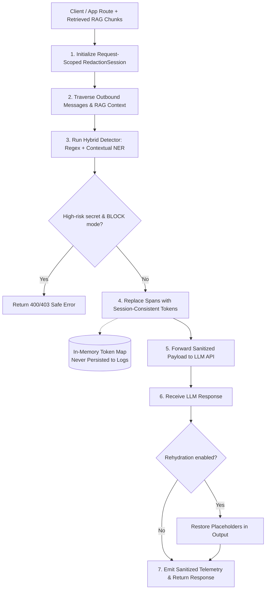
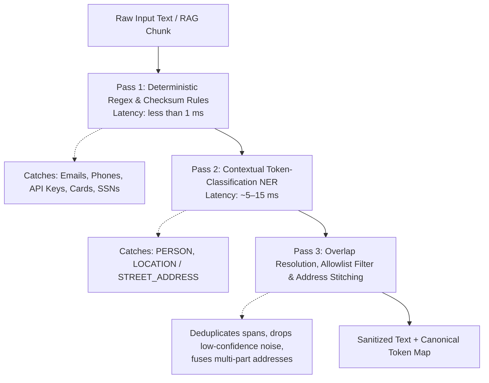

---
> **TL;DR** — The 90-Day Execution Blueprint
>
>    Days 1–30 (Assess & Contain): Publish an Acceptable Use Policy, uncover Shadow AI across network/OAuth telemetry, block unapproved consumer endpoints, enforce Zero Data Retention (ZDR), and build your living AI-BOM.
>
>    Days 31–60 (Architect & Govern): Route traffic through a centralized AI Gateway, enforce identity-driven pre-filtering on RAG pipelines, bound autonomous agents with short-lived Non-Human Identities (NHIs) and HITL gates, and stand up a fast-track AI Governance Committee.
>
>    Days 61–90 (Automate & Scale): Stream AI telemetry into your SIEM, automate OWASP/MITRE ATLAS red-team regressions in CI/CD, run tabletop incident exercises (AIRP-001), and roll out role-specific developer and employee training.
---


Every time your application sends a prompt to an external Large Language Model (LLM) API, that payload crosses a trust boundary. Customer names, email addresses, phone numbers, street addresses, account identifiers, and API keys routinely travel inside user messages, Retrieval-Augmented Generation (RAG) context chunks, and agent tool arguments—often before any security check runs.

Our upcoming **PII Redaction Middleware for LLM APIs** sits directly in the request path to detect, tokenize, and strip sensitive data **before** inference calls leave your perimeter. Below is the complete blueprint behind what we are building: the problem we are solving, current production pain points, real-world case studies, our two-stage hybrid detection architecture, end-to-end Mermaid flowcharts, and a drop-in TypeScript template.

---

## 1. The Problem We Are Solving

Modern LLM applications no longer pass isolated single-line prompts—they pass multi-turn conversation histories, retrieved knowledge-base chunks, structured JSON payloads, and tool-call parameters. Once raw Personally Identifiable Information (PII) or secrets reach a third-party inference endpoint or an unredacted observability log, you lose direct control over where that data is cached, logged, or processed.

Our middleware addresses three core failure modes:
* **Unintentional data leakage across prompts and RAG context:** Users paste emails, phone numbers, home addresses, and credentials into chat inputs, while RAG pipelines silently pull sensitive customer records from internal databases into outbound prompts.
* **Broken reasoning and personalization when redacting naively:** Replacing sensitive values with static strings like `[REDACTED]` strips relational context—preventing the LLM from linking a person in the user's question to their record in a retrieved document, or preventing your app from restoring clean values in the final reply.
* **Fragmented, ad-hoc security checks:** Teams scatter ad-hoc regex snippets across individual routes or SDK wrappers, leaving background workers, streaming endpoints, and agentic tool loops unprotected.

---

## 2. Current Pain Points in LLM Data Protection

Even when engineering teams recognize the compliance and privacy risk, existing approaches create major friction in production:

1. **Regex-only filters miss unstructured PII:** Pattern matching catches rigid formats like emails and API keys, but fails completely on person names (`"Meera Kapoor"`), multi-line street addresses (`"18 Park Street, Kolkata"`), and free-form conversational context.
2. **Heavyweight ML pipelines add tail latency:** Running large detection models synchronously across every raw string without fast pre-filtering introduces noticeable latency spikes on long-context prompts.
3. **Independent chunk redaction breaks RAG accuracy:** Redacting the user query and retrieved RAG chunks in separate passes assigns mismatched placeholders (`<PERSON_1>` in the query vs. `<PERSON_2>` in the context), breaking the LLM's ability to connect facts.
4. **External sanitization APIs widen the trust boundary:** Sending unredacted text to a third-party redaction service before calling your LLM still exposes raw PII outside your infrastructure.

---

## 3. Real-World Case Studies: Why Pre-Inference Redaction Is Critical

Abstract security warnings rarely convince engineering teams to change their architecture—real incidents do. These real-world cases illustrate what happens when sensitive data leaves your perimeter unredacted, the resulting business fallout, and how pre-inference middleware stops the leak before it happens.

### Case Study 1: Samsung Semiconductor Engineers & Proprietary Data Exposure (2023)
* **What Happened:** Shortly after Samsung's semiconductor division lifted an internal ban on external generative AI tools in early 2023, engineers pasted sensitive internal payloads into ChatGPT across multiple incidents—including proprietary source code for debugging, confidential chip fault-optimization test sequences, and internal meeting notes for presentation generation.
* **Root Cause:** There was no automated content-aware inspection or redaction layer intercepting outbound prompts before they left the corporate perimeter.
* **Impact:** Irretrievable exposure of proprietary engineering IP outside the organization, followed by an emergency clampdown on generative AI usage that slowed developer workflows while internal controls were put in place.
* **How Pre-Inference Middleware Helps:** Stripping secrets, internal identifiers, and sensitive strings before the API request leaves your network lets engineering teams use external LLMs safely without resorting to blunt tool bans.
* **References:** [MIT AI Risk Repository — ChatGPT Implicated in Samsung Data Leak](https://airisk.mit.edu/ai-incidents/768-chatgpt-implicated-in-samsung-data-leak-of-source-code) · [AI Incident Database (Incident 768)](https://incidentdatabase.ai/cite/768/)

### Case Study 2: The ChatGPT Redis Cache Bug & Regulatory Scrutiny (2023)
* **What Happened:** On March 20, 2023, a bug in an open-source caching library (`redis-py`) used by OpenAI caused a cache exposure window in which some users could see chat history titles and first messages belonging to other users, as well as payment/account details for a small subset of active ChatGPT Plus subscribers. Within ten days, Italy's data protection authority (*Garante*) ordered OpenAI to temporarily halt processing Italian users' data while investigating privacy and data-protection compliance.
* **Root Cause:** Even when an application calls an external LLM API, infrastructure bugs or cache mishandling on the downstream side can expose raw prompt content and personal data that was sent in clear text.
* **Impact:** Service disruption, user trust erosion, emergency patches, and swift regulatory intervention in major markets.
* **How Pre-Inference Middleware Helps:** When your middleware replaces real names, emails, and addresses with request-scoped tokens (`<PERSON_1>`, `<EMAIL_1>`) before sending the payload out, any downstream leak exposes meaningless placeholders rather than raw customer PII.
* **References:** [Clifford Chance — Italian Data Protection Authority Halts ChatGPT's Data Processing](https://www.cliffordchance.com/insights/resources/blogs/talking-tech/en/articles/2023/04/the-italian-data-protection-authority-halts-chatgpt-s-data-proce.html) · [Regulated Data Risk — OpenAI March 2023 ChatGPT User Data Exposure Incident](https://regulateddatarisk.com/posts/openai-march-2023-chatgpt-user-data-exposure-incident)

### Case Study 3: AI Governance Gaps, Shadow AI & Breach Costs (IBM Cost of a Data Breach 2026)
* **What Happened:** As enterprises deploy LLM apps, RAG pipelines, and autonomous agents, unmonitored "shadow AI" and weak access/data governance frequently expand the attack surface. According to IBM's *Cost of a Data Breach Report 2026*, the global average cost of a data breach reached a record **$4.99 million** (up 12% year-over-year), while **68% of breached organizations lacked AI governance** to manage AI or detect shadow AI, and security incidents involving shadow AI reached **43%** (averaging **$5.39 million** in breach cost). In India, the average cost of a data breach hit a record **INR 255 million (INR 25.5 crore)** in 2026, with shadow AI adding an average of **INR 17.9 million** where present.
* **Root Cause:** Teams wire up LLM prompts and RAG retrievers quickly without inline inspection of prompts, secrets, or retrieved context—leaving sensitive personal and business data exposed across logs, prompts, and unvetted AI workflows.
* **Impact:** Higher breach costs, longer incident containment cycles, and heavy compliance exposure under privacy frameworks.
* **How Pre-Inference Middleware Helps:** Enforcing inline pre-inference redaction across both user prompts and retrieved RAG chunks closes a critical governance gap before sensitive data ever leaves your environment.
* **References:** [IBM Cost of a Data Breach Report 2026](https://www.ibm.com/reports/data-breach) · [IBM India Cost of a Data Breach Report 2026](https://in.newsroom.ibm.com/India-Records-its-Highest-Average-Cost-of-a-Data-Breach-2026)

### Impact Summary

| Incident / Trend | What Was Exposed / At Risk | Key Consequence | Pre-Inference Middleware Mitigation |
| :--- | :--- | :--- | :--- |
| **Samsung AI Leak (2023)** | Proprietary source code, chip test data, internal notes | IP exposure & temporary AI ban | Strips secrets & sensitive entities before outbound calls |
| **ChatGPT Cache Bug (2023)** | Prompt histories & user/account data in cache window | Service halt, user alarm & regulatory action | Sends `<PERSON_1>` / `<EMAIL_1>` instead of raw PII |
| **Shadow AI & AI Governance Gap (2026)** | Uncontrolled AI prompts, secrets & data flows | Record breach costs ($4.99M global / INR 255M India) & 68% AI governance gap | Enforces consistent, auditable redaction on prompts & RAG chunks |

---

## 4. How We Are Solving It: Hybrid Detection & Shared-State Sessions

Our middleware treats PII sanitization as an **in-process, pre-inference layer** wrapped around your LLM client or HTTP handler.

### Core Architectural Pillars
* **Drop-in middleware placement:** Intercepts outbound payloads right before the provider SDK or HTTP call executes—requiring zero changes to your core prompt logic.
* **Two-stage hybrid detection (Fast Rules + Contextual NER):** Combines sub-millisecond deterministic regexes (for emails, phone numbers, API keys, and tokens) with a lightweight local Named Entity Recognition (NER) model (such as an ONNX-quantized token classifier or Microsoft Presidio) for names and addresses.
* **Multi-token address stitching:** Standard NER models often split a single address into separate city, street, and postal-code tags. Our span merger fuses adjacent location spans separated only by spaces or punctuation into one unified `<ADDRESS_1>` token.
* **Canonical `RedactionSession` across prompts & RAG chunks:** Maintains a single request-scoped bidirectional lookup map (`"Meera Kapoor" <-> "<PERSON_1>"`) across multi-turn messages and all retrieved RAG chunks so identical entities always map to the same placeholder—and can be safely rehydrated in the final response without ever writing raw PII to logs.
* **Fail-safe policy modes:** Supports per-environment enforcement (`redact_and_continue`, `block_on_high_risk`, or `audit_only`) for safe, incremental rollouts.

---

## 5. End-to-End Middleware Flow & Hybrid Detection Pipeline

### Request & Response Lifecycle



### Inside Stage 3: Two-Stage Hybrid Detection



### How It Works on a Live RAG Request
* **User Query:** `"What is the delivery status for Meera Kapoor at 18 Park Street, Kolkata?"`
* **RAG Chunk:** `"Customer Meera Kapoor (meera@example.com) — Shipment scheduled for 18 Park Street, Kolkata."`
* **Payload Sent to LLM API:**
  * Query: `"What is the delivery status for <PERSON_1> at <ADDRESS_1>?"`
  * Context: `"Customer <PERSON_1> (<EMAIL_1>) — Shipment scheduled for <ADDRESS_1>."`

Because `<PERSON_1>` and `<ADDRESS_1>` match across both the prompt and the retrieved chunk, the LLM reasons accurately over the relationship without ever seeing Meera's real name, email, or home address.

---

## 6. Production Implementation Template (TypeScript)

Use this complete, drop-in TypeScript pattern combining deterministic regexes, pluggable contextual NER detection, multi-token address stitching, and shared-session RAG redaction:

```ts
export type PiiEntityType = "EMAIL" | "PHONE" | "SECRET" | "PERSON" | "ADDRESS";

export interface DetectedSpan {
  type: PiiEntityType;
  value: string;
  start: number;
  end: number;
  confidence: number;
}

export interface NerModelProvider {
  predict(text: string): Promise<DetectedSpan[]>;
}

export interface RagChunk {
  id: string;
  source: string;
  content: string;
}

export interface RedactionTelemetry {
  entitiesRedacted: Record<string, number>;
  blocked: boolean;
}

const REGEX_RULES: Array<{ type: PiiEntityType; regex: RegExp }> = [
  { type: "EMAIL", regex: /\b[A-Z0-9._%+-]+@[A-Z0-9.-]+\.[A-Z]{2,}\b/gi },
  { type: "PHONE", regex: /\b(?:\+?\d{1,3}[\s.-]?)?(?:\(?\d{3}\)?[\s.-]?)\d{3}[\s.-]?\d{4}\b/g },
  { type: "SECRET", regex: /\b(?:sk-[A-Za-z0-9_-]{16,}|ghp_[A-Za-z0-9]{20,})\b/g },
];

export class RedactionSession {
  private valueToToken = new Map<string, string>();
  private tokenToValue = new Map<string, string>();
  private typeCounters: Record<string, number> = {};

  constructor(
    private nerProvider: NerModelProvider,
    private minConfidence = 0.85,
    private allowlist = new Set<string>()
  ) {}

  private getOrCreateToken(type: PiiEntityType, rawValue: string): string {
    const normalized = rawValue.trim();
    const existing = this.valueToToken.get(normalized);
    if (existing) return existing;

    this.typeCounters[type] = (this.typeCounters[type] ?? 0) + 1;
    const token = `<${type}_${this.typeCounters[type]}>`;

    this.valueToToken.set(normalized, token);
    this.tokenToValue.set(token, normalized);
    return token;
  }

  /**
   * Fuses adjacent ADDRESS spans separated only by punctuation or whitespace
   * (e.g., street + city + postal code -> single <ADDRESS_1> token).
   */
  private mergeAdjacentAddresses(text: string, spans: DetectedSpan[]): DetectedSpan[] {
    const merged: DetectedSpan[] = [];
    for (const span of spans) {
      const prev = merged[merged.length - 1];
      if (
        prev &&
        prev.type === "ADDRESS" &&
        span.type === "ADDRESS" &&
        /^[\s,.-]+$/.test(text.slice(prev.end, span.start))
      ) {
        prev.end = span.end;
        prev.value = text.slice(prev.start, span.end);
        prev.confidence = Math.min(prev.confidence, span.confidence);
      } else {
        merged.push({ ...span });
      }
    }
    return merged;
  }

  async redactText(input: string): Promise<string> {
    if (!input.trim()) return input;

    const candidates: DetectedSpan[] = [];

    // 1. Fast deterministic regex pass
    for (const { type, regex } of REGEX_RULES) {
      regex.lastIndex = 0;
      let match: RegExpExecArray | null;
      while ((match = regex.exec(input)) !== null) {
        candidates.push({
          type,
          value: match[0],
          start: match.index,
          end: match.index + match[0].length,
          confidence: 1.0,
        });
      }
    }

    // 2. Contextual NER pass for PERSON & ADDRESS spans
    const nerSpans = await this.nerProvider.predict(input);
    for (const span of nerSpans) {
      if (span.confidence >= this.minConfidence && !this.allowlist.has(span.value.trim())) {
        candidates.push(span);
      }
    }

    // 3. Sort, deduplicate overlaps (higher confidence/longer span wins), and stitch addresses
    candidates.sort((a, b) => a.start - b.start || b.confidence - a.confidence || b.end - a.end);

    const nonOverlapping: DetectedSpan[] = [];
    let cursor = 0;
    for (const span of candidates) {
      if (span.start >= cursor) {
        nonOverlapping.push(span);
        cursor = span.end;
      }
    }

    const finalSpans = this.mergeAdjacentAddresses(input, nonOverlapping);

    // 4. Replace spans using session-wide consistent tokens
    let output = "";
    let lastIdx = 0;
    for (const span of finalSpans) {
      const token = this.getOrCreateToken(span.type, span.value);
      output += input.slice(lastIdx, span.start) + token;
      lastIdx = span.end;
    }
    output += input.slice(lastIdx);

    return output;
  }

  rehydrate(modelResponse: string): string {
    let result = modelResponse;
    for (const [token, original] of this.tokenToValue.entries()) {
      result = result.split(token).join(original);
    }
    return result;
  }

  getTelemetry(): RedactionTelemetry {
    return {
      entitiesRedacted: { ...this.typeCounters },
      blocked: false,
    };
  }
}

// Middleware wrapper protecting both user prompts and retrieved RAG chunks
export async function runProtectedRagInference(
  userQuery: string,
  ragChunks: RagChunk[],
  nerProvider: NerModelProvider,
  callLlm: (sanitizedPrompt: string) => Promise<string>,
  options = { rehydrate: true, allowlist: ["Acme Corp"] }
): Promise<string> {
  const session = new RedactionSession(nerProvider, 0.85, new Set(options.allowlist));

  // Scan user query and all RAG chunks concurrently under one shared session
  const [cleanQuery, cleanChunks] = await Promise.all([
    session.redactText(userQuery),
    Promise.all(
      ragChunks.map(async (chunk) => ({
        ...chunk,
        content: await session.redactText(chunk.content),
      }))
    ),
  ]);

  // Safe to log aggregate entity counts—never raw prompts or token maps
  console.info("PII pre-flight telemetry:", session.getTelemetry());

  const assembledPrompt = [
    "Answer using the sanitized context below:",
    ...cleanChunks.map((c) => c.content),
    `User Question: ${cleanQuery}`,
  ].join("\n\n");

  const rawReply = await callLlm(assembledPrompt);
  return options.rehydrate ? session.rehydrate(rawReply) : rawReply;
}
```

---

## 7. Summary: Turning Strategy into Repeatable Execution

Securing enterprise AI does not require halting business momentum or waiting years for multi-phase transformations. By sequencing controls into three focused 30-day sprints, security and engineering teams can rapidly eliminate blind spots in Month 1, embed architectural guardrails into the platform layer in Month 2, and operationalize continuous monitoring, red teaming, and governance in Month 3.
